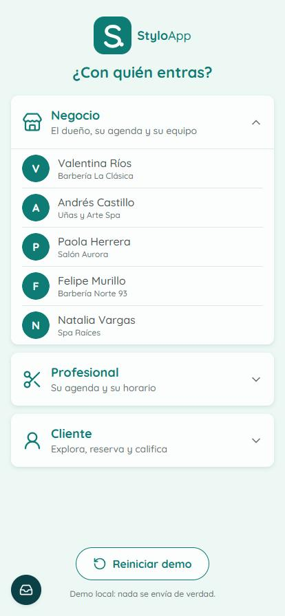
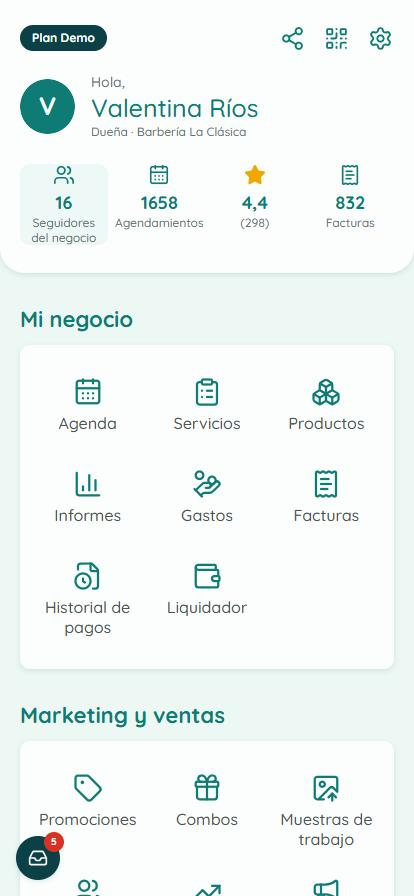
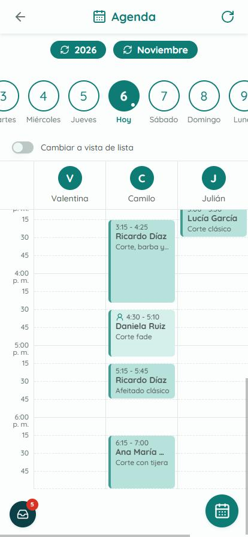
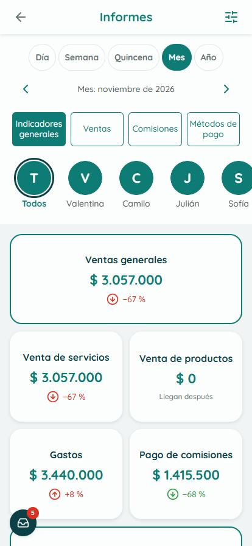
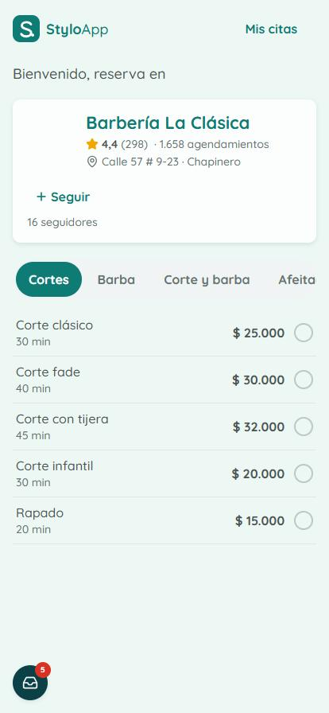

# StyloApp

**Demo de agenda y gestión para barberías, salones de uñas y spas en Colombia**, con sus tres lados conectados en
tiempo real: el negocio (dueño), el equipo (profesionales) y los clientes (app de reservas y página por enlace).

**Demo en línea:** https://styloapp-demo.vercel.app · se instala en el celular como app (PWA).

> Todos los datos son ficticios: personas, negocios, celulares (+57 300 555 0xxx), citas y dinero. Los SMS, WhatsApp
> y avisos no salen de la app: llegan a una **bandeja de la demo** (el botón redondo abajo a la izquierda).

<p>
  
  
  
  
  
</p>

## Qué problema resuelve

Una barbería o un salón pequeño suele llevar la agenda en un cuaderno o en el WhatsApp del dueño: se cruzan citas,
nadie sabe cuánto vendió cada profesional y el cliente tiene que escribir para saber si hay espacio. StyloApp junta
en una sola app la agenda del equipo, las reservas de los clientes, las ventas, los gastos y el pago a los
profesionales, con los datos de los tres lados compartidos en tiempo real.

## Cómo probar la demo

1. Abre https://styloapp-demo.vercel.app y elige con quién entrar (por ejemplo **Negocio → Valentina Ríos**).
2. Toca **Enviar código** y abre la **bandeja de la demo**: ahí llega el "SMS" con el código de 6 dígitos.
3. Escribe el código y entras. **Reiniciar demo** (en la portada) deja los datos como nuevos.

## Funcionalidades

- **Entrada con celular y código** (Supabase Auth por teléfono, con un proveedor de SMS simulado que escribe en la
  bandeja de la demo).
- **Negocio y equipo:** perfil, horario, servicios y categorías, productos, equipo con permisos por rol, precio y
  comisión por profesional, y vinculación de profesionales con código.
- **Agenda:** vista por profesional y en lista; crear, mover, cancelar y cerrar citas; llegada del cliente;
  bloqueos de espacios y de clientes; citas recurrentes; avisos y recordatorios.
- **Clientes:** ficha con historial, notas, filtros y bloqueo.
- **Dinero:** facturas, gastos, liquidador (pago a profesionales por comisión), historial de pagos e informes por
  día, semana, quincena, mes y año, con comparación contra el periodo anterior.
- **App de clientes:** explorar negocios en mapa (Leaflet), ofertas, página del negocio, reservar, "Mis reservas",
  calificar y reputación.
- **Página de reservas por enlace** (`/n/[slug]`) con código QR para compartir.
- **PWA:** instalable, pantalla sin conexión, modo día y noche según el celular, imágenes de arranque para iPhone.

## Stack

| Capa          | Tecnología                                                                |
| ------------- | ------------------------------------------------------------------------- |
| Frontend      | Next.js 16 (App Router, Server Components), React 19, TypeScript          |
| UI            | Tailwind CSS 3.4, shadcn/ui (Radix), lucide-react, Leaflet                |
| Backend       | Supabase: PostgreSQL, Auth por teléfono, Row Level Security, Realtime      |
| Estado y datos| Zustand, Zod, date-fns con zona horaria de Bogotá                          |
| Pruebas       | Vitest (unitarias y de base de datos) y Playwright (E2E en 4 tamaños)     |
| Despliegue    | Vercel + Supabase en la nube                                              |

Arquitectura *feature-first*: cada módulo (`src/features/agenda`, `booking`, `invoices`, `payroll`…) tiene sus
componentes, servicios, tipos y reglas puras. La lógica sensible (horas libres, reputación, liquidación) vive en
funciones SQL y políticas RLS, no en el navegador.

```
src/
├── app/           # Rutas: /, (auth)/entrar, pro/* (negocio y equipo), app/* (clientes), n/[slug], bandeja
├── features/      # demo, auth, business, team, catalog, agenda, booking, clients, invoices, expenses,
│                  # payroll, reports, reviews, explore, home
├── shared/        # Componentes y utilidades (fechas de Bogotá, pesos colombianos, celulares +57)
└── lib/supabase/  # Clientes de navegador, servidor y administración
supabase/          # config.toml, migraciones SQL (esquema, RLS, funciones) y semilla con datos ficticios
tests/             # unit/, db/ y e2e/
```

## Pruebas

| Tipo                                  | Cantidad | Cómo se corren                         |
| ------------------------------------- | -------- | -------------------------------------- |
| Unitarias (reglas puras)              | 249      | `npx vitest run tests/unit`            |
| Base de datos (RLS, funciones SQL)    | ~110     | `npm test` (con Supabase local)        |
| E2E con Playwright                    | ~135     | `npm run e2e` (con Supabase local)     |

## Correrlo en local

Requisitos: Node.js 20 o más nuevo, Docker (para el Supabase local) y npm.

```bash
npm install
cp .env.example .env.local
npm run db:start     # Supabase local en Docker; imprime la URL, la llave anon y la service_role
# pega esas llaves en .env.local
npm run db:reset     # aplica las migraciones y la semilla con datos ficticios
npm run dev          # http://localhost:3000
```

Para usar un Supabase en la nube en vez del local: crea un proyecto, aplica las migraciones con
`npx supabase link --project-ref <tu-ref>` y `npx supabase db push --include-seed`, y pon en `.env.local` (o en las
variables de Vercel) `SUPABASE_URL`, `NEXT_PUBLIC_SUPABASE_URL`, `NEXT_PUBLIC_SUPABASE_ANON_KEY` y
`SUPABASE_SERVICE_ROLE_KEY`. La entrada por celular necesita activar el proveedor de teléfono con el hook de SMS de
la demo (`send_sms_demo`, en las migraciones) en vez de un proveedor real.

Otros comandos: `npm run build`, `npm run lint`, `npm run typecheck`, `npm run test:coverage`.

## Cómo se construyó

Desarrollo asistido por IA con **Claude Code** como motor principal de código. Antes de programar se escribieron
los requisitos del producto (PRD), la especificación técnica, las historias de usuario con criterios de aceptación y
un plan por fases; cada fase se construyó con agentes de IA en paralelo y pasó compuertas de calidad (lint, tipos,
pruebas unitarias, de base de datos y E2E) antes de cerrarse. Yo definí los requisitos, tomé las decisiones de
producto y arquitectura, revisé el código, probé la app y la publiqué.

---

Hecho por **Daiver Marmolejo Correa** · Desarrollador Full Stack con IA · [github.com/daivermco-code](https://github.com/daivermco-code)
